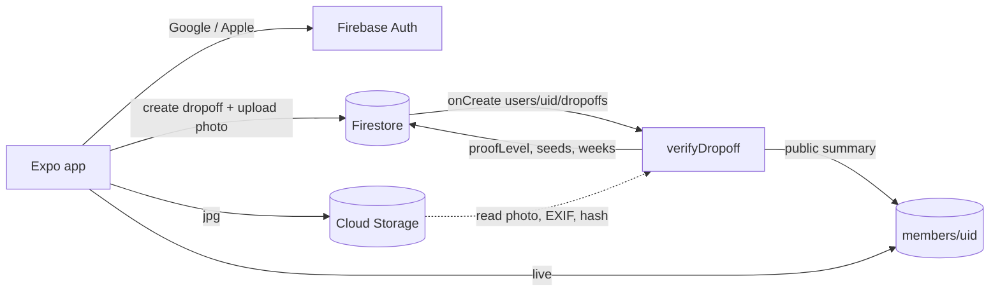

# Design – GroundLoop MVP

## Overview

An Expo app talks directly to Firebase for reads and simple writes. Anything that affects trust (proof level, seeds, streak, public member stats, cheer counts) is computed by Cloud Functions so a modified client cannot fake it.

## Data model (Firestore)

| Path | Written by | Fields |
|---|---|---|
| `users/{uid}` | client (limited) + functions | `displayName`, `homeRegion`, `currentRegion`, `travel`, `usualSite {region, siteId}`, `homeGeo {lat,lng}` (curbside only, optional), `createdAt` · **functions only:** `seeds`, `weeks[]`, `paused[]`, `freezes`, `best`, `lastDropAt`, `photoHashes[]`, `proofCounts {self,photo,verified}` |
| `users/{uid}/dropoffs/{id}` | client creates, functions finalise | `createdAt`, `region`, `siteId?`, `siteLabel`, `geo {lat,lng,accuracy}?`, `photoPath?`, `careful` · **functions only:** `proofLevel`, `seedsAwarded`, `checks {fresh, duplicate, distanceM}`, `status` |
| `members/{uid}` | functions only | `displayName`, `photoURL`, `region`, `streak`, `best`, `proofCounts`, `updatedAt` |
| `posts/{id}` | client creates own | `uid`, `kind`, `text`, `region`, `photoPath?`, `createdAt` · **functions only:** `cheerCount` |
| `posts/{id}/cheers/{uid}` | client (own uid, not post author) | `createdAt` |
| `reports/{id}` | client creates | `postId`, `uid`, `reason`, `createdAt` |
| `siteRequests/{id}` | client creates own | `uid`, `region`, `lat`, `lng`, `note`, `createdAt` |
| `hostOffers/{id}` | client creates own | `uid`, `region`, `name`, `type`, `address`, `status`, `createdAt` |

Storage: `proofs/{uid}/{dropoffId}.jpg`, writable only by `uid`, ≤ 5 MB, `image/jpeg`.

## Verification (`verifyDropoff`, Firestore onCreate)

1. Load the drop-off and user. Reject if the user already has 3 drop-offs today (rate limit).
2. **Photo:** download from Storage, read EXIF `DateTimeOriginal` with `exifr`, check |capture − createdAt| ≤ 15 min. Compute an 8×8 average hash with `sharp` (greyscale, resize 8×8, threshold at the mean). Duplicate if Hamming distance ≤ 4 from any of the last 100 hashes.
3. **Location:** find the site in the region list (bundled in `functions/src/regions.json`, generated from `src/data/regions.ts`). Pass if distance ≤ 75 m and accuracy ≤ 50 m. For curbside or station cities, compare with `homeGeo`.
4. Proof level = `verified` | `photo` | `self` (Requirement 4.4). Seeds = 5/10/15 + 5 if `careful`.
5. Add the ISO week key (computed in the user's time zone sent as `tz`) to `weeks`. Recompute streak with `src/lib/streak.ts` logic (shared copy in functions). Grant a freeze at multiples of 4 (max 2).
6. Write the drop-off result, update the user, and rebuild `members/{uid}`.

A scheduled function `weeklyUpkeep` (Mondays 03:00 UTC) spends a freeze for users who missed last week, and pauses the week for users in travel mode.

### Later: partner-verified proof
Add a `partnerEvents` collection that haulers or smart locks write through an authenticated service account (bin opened by user X at site Y, or RFID cart tag scanned). `verifyDropoff` then upgrades matching drop-offs to `partner`.

## Streak maths (`src/lib/streak.ts`)

- `weekKey(date, tz)` → `"2026-W43"` (ISO 8601).
- `streak(weeks, paused, now)` walks back week by week from the current week (skipped if not yet done): done → +1, paused → skip, otherwise stop.

## Screens

| Screen | Key components |
|---|---|
| Sign-in | Mascot (rotating), Google button, Apple button (`AppleAuthenticationButton`) |
| Home | Greeting, `WeekStrip` (8 weeks), Peel with ripeness, log button, usual site, community preview |
| Log | Site list → Camera capture → Location permission prompt → Careful-sorting checkbox → Submit → result from function (listens on the drop-off doc until `status == 'verified'`) |
| Map | `react-native-maps` markers, directions via `Linking.openURL` to Apple/Google Maps, long-press to suggest a bin |
| Check | Search, popular items, verdict card |
| Community | Composer, consistency board, feed with cheers and report |
| You | Profile, home/current city, travel mode, freezes, 16-week calendar, proof mix, history, recap, sign out |

## Error handling
- Network failures: Firestore offline persistence queues writes. The log flow shows "Saved. We'll verify it when you're back online."
- Permission denied (camera or location): continue with lower proof and explain what was skipped.
- Function failure: drop-off stays `pending`. A retry function re-runs pending items older than 10 minutes.

## Testing
- Unit tests for `streak`, `geo`, `verdict` (Jest via `jest-expo`).
- Firestore rules tests with `@firebase/rules-unit-testing` against the emulator.
- Function tests against the emulator with fixture photos (fresh, old EXIF, duplicate).
